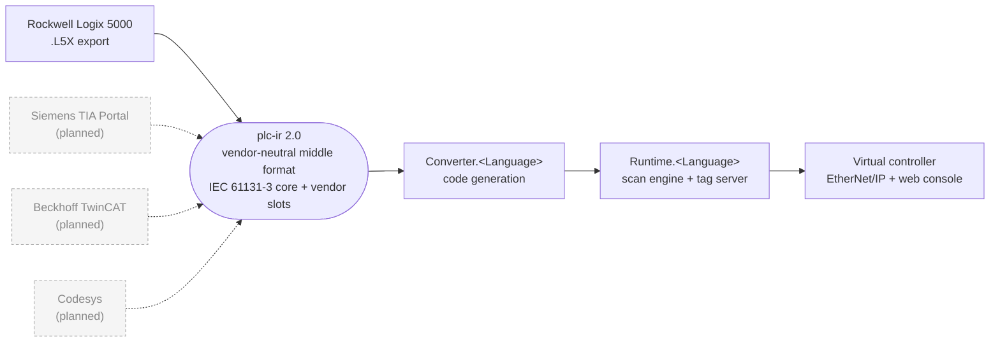
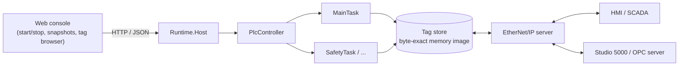
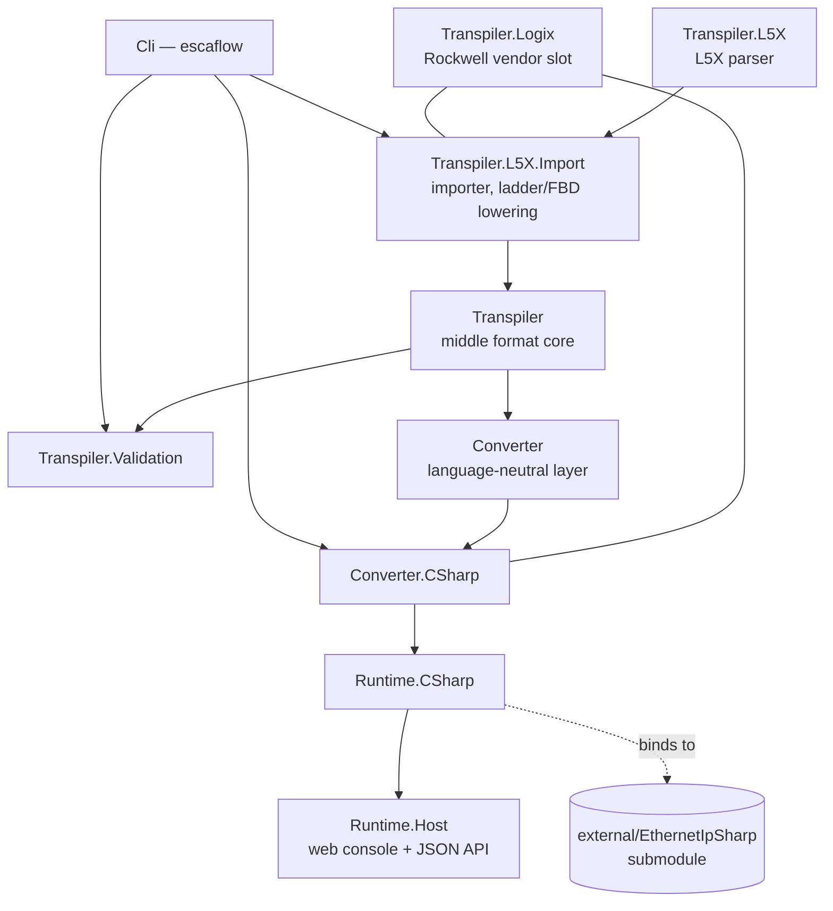

# EscaFlow

[](LICENSE)
[](https://dotnet.microsoft.com/)
[](#known-gaps)
[](docs/plc-ir-2.0.md)

**A vendor-neutral PLC transpiler.** EscaFlow turns PLC projects into generated code plus a runtime
that runs the result as a **virtual controller**: the generated program scans like the original PLC,
keeps every tag in a byte image laid out like the source controller, and serves that image live over
industrial protocols, so HMIs, OPC servers and other controllers read and write it exactly as they
would the real thing. A web console starts and stops the controller, saves and loads snapshots and
browses tag values.

Rockwell Logix 5000 (`.L5X` exports) is the first supported front-end. The middle format in between is
deliberately vendor-neutral — IEC 61131-3, not Logix — so a Siemens, Beckhoff or Codesys front-end can
be added later without teaching any of it Rockwell's instruction set, and a new target language only
ever has to read one format.



Once a controller is generated and running, the web console and real clients all talk to the same tag
image:



Written in C# for .NET 10 by Cristian Mori. Licensed under Apache-2.0 (see `LICENSE`).

## Layout and naming



| Project | Role |
|---|---|
| `src/Mori.EscaFlow.Transpiler` | The middle format (plc-ir 2.0): model, JSON reader/writer, walker, structured-text printer, JSON Schema generator, catalogs of atomic types, standard function blocks and standard functions. No dependencies. |
| `src/Mori.EscaFlow.Transpiler.Validation` | Validator for middle files: structural, referential and typing passes (`IRVnnn` codes). |
| `src/Mori.EscaFlow.Transpiler.Logix` | The Rockwell flavour of the middle format: typed views of the `vendor.logix` slots, the MESSAGE and socket model, the Logix service catalog. Used by importers and converters alike. |
| `src/Mori.EscaFlow.Transpiler.L5X` | The L5X parser: a streaming reader that turns an export into a complete object model (types, modules, add-ons, tags with values, programs, ladder, structured text, SFC, FBD, tasks) with a linker and scope resolver. |
| `src/Mori.EscaFlow.Transpiler.L5X.Import` | The importer: builds the middle file from the parsed model, including ladder lowering, dataflow lowering, prescan synthesis and subroutine binding. |
| `src/Mori.EscaFlow.Converter` | Language-neutral converter layer: generated-file model, naming tally, Logix structure layout calculator, code writer, generation report. |
| `src/Mori.EscaFlow.Converter.CSharp` | The C# converter: emits a complete solution per project. |
| `src/Mori.EscaFlow.Runtime.CSharp` | The C# runtime (namespace `Mori.EscaFlow.Runtime`): value wrappers over EthernetIPSharp tag memory, structures and arrays, scan engine, system status, Logix timers and counters, services, snapshots, EtherNet/IP server. |
| `src/Mori.EscaFlow.Runtime.Host` | The web console and JSON API over `IPlcController`. |
| `src/Mori.EscaFlow.Cli` | The `escaflow` command line tool. |
| `external/EthernetIpSharp` | Git submodule: the EtherNet/IP and Logix tag server library (branch `master`). |
| `tests/` | One test project per package plus `tests/Conformance` (crafted L5X fixtures and their golden middle files). |
| `docs/` | `plc-ir-2.0.md` (middle format contract), `csharp-generator.md` (converter / runtime / host contract), `ir-1.0.md` (retired first format), `plc-ir-2.0-standard.docx` (work-in-progress standalone write-up of the middle format, for readers who want a document instead of the Markdown contract). |

Naming rule: `Mori.EscaFlow.Transpiler.*` is everything that produces or describes the middle format,
`Mori.EscaFlow.Converter.<Language>` turns it into a target language, `Mori.EscaFlow.Runtime.<Language>`
runs the generated code. A second front-end (Siemens, Beckhoff, Codesys) would be
`Mori.EscaFlow.Transpiler.<Vendor>` producing the same middle format.

## Build, test, run

```
git clone --recurse-submodules https://github.com/CristianMori/Mori.EscaFlow.git
cd EscaFlow
dotnet build Mori.EscaFlow.slnx
dotnet test                                   # unit + integration (integration tests skip when the sample exports are absent)
dotnet test --filter Category!=Integration    # unit tests only
```

Integration tests look for the sample exports in the repository root or in the directory named by the
`L5X_SAMPLES_DIR` environment variable. Conformance goldens are regenerated with
`PLC_IR_UPDATE_GOLDEN=1 dotnet test tests/Mori.EscaFlow.Transpiler.L5X.Import.Tests`, the JSON Schema
with `PLC_IR_UPDATE_SCHEMA=1 dotnet test tests/Mori.EscaFlow.Transpiler.Tests`.

The command line tool:

```
dotnet run -c Release --project src/Mori.EscaFlow.Cli -- parse <file.L5X> [--summary] [--diagnostics] [--json out.json] [--no-values] [--no-logic] [--validate-values] [--keep-l5k] [--threads n] [--strict]
dotnet run -c Release --project src/Mori.EscaFlow.Cli -- ir build <file.L5X> <out.ir.json> [--no-values] [--no-source] [--no-prescan] [--indent] [--validate]
dotnet run -c Release --project src/Mori.EscaFlow.Cli -- ir validate <file.ir.json> [--no-typing] [--warnings]
dotnet run -c Release --project src/Mori.EscaFlow.Cli -- ir print <file.ir.json> [Pou[/Action]]
dotnet run -c Release --project src/Mori.EscaFlow.Cli -- generate csharp <file.L5X|file.ir.json> <outDir> [--name N] [--runtime path] [--host path] [--eip-port n|none] [--url http://localhost:5080] [--strict-services]
```

Running a generated controller:

```
dotnet run -c Release --project src/Mori.EscaFlow.Cli -- generate csharp MyProject.L5X out/MyProject
cd out/MyProject
dotnet run --project MyProject.Host        # web console on http://localhost:5080, EtherNet/IP on 44818
```

The generated solution references the runtime and host projects of this repository by path (`--runtime`
and `--host` override the paths).

## What it does today

- **Parser**: the whole L5X format: data types (user, predefined from the Rockwell manuals, module-defined learned from the export), modules with ports and connections, add-on instructions, tags with Decorated and L5K values, aliases, programs, routines in ladder (full rung grammar), structured text (full statement and expression grammar), SFC and FBD, tasks, MESSAGE configuration including socket services. Every operand resolves to its declaring tag and leaf type.
- **Middle format**: IEC 61131-3 core (configuration, resources, tasks, program instances, POUs with variable sections, types, typed statement and expression trees, standard function blocks with pin profiles, vendor service calls) with a `vendor.logix` slot for everything Rockwell-only. Ladder is kept as drawn and lowered to statements; FBD is lowered in dataflow order; JSR/SBR/RET are bound to assignments; prescan behaviour is synthesized per program and add-on.
- **Validator**: references, types, pins, services, labels, aliases, tasks; a strict JSON read rejects unknown members.
- **C# converter**: a class per structure type with the Logix byte layout, per add-on instruction (`Execute`, `Prescan`, `Postscan`, `EnableInFalse`), per program (routines as methods), and a controller class with every tag, module image, program instance and task; alias and naming tallies and the instruction inventory in `generation-report.json`.
- **Runtime**: every atomic leaf is a wrapper bound to EthernetIPSharp tag memory, so logic and EtherNet/IP clients share one image; continuous, periodic and event tasks on their own threads with watchdogs and statistics; first-scan and system status; Logix timers and counters (TON, TOF, RTO, CTU, CTD); standard functions; GSV/SSV/EVENT services; snapshots; the EtherNet/IP tag server with program scopes, templates and symbol browsing.
- **Web console**: state and mode, start/stop, per-task scan statistics, save/load/download/upload snapshots, tag browser with live values and writes.

Verified on three production exports (up to 212 MB, 14,700 rungs, 755 generated files): every reference
resolves, the middle files validate, the generated solutions compile, and the generated controllers scan.

## Known gaps

- Vendor services beyond GSV/SSV/EVENT/IOT/UID/UIE (FBD-style timers such as TONR and OSRI, PIDE, SCL, file and sequencer instructions, motion, phase and safety instructions) are not implemented in the runtime. They compile to `Services.Unsupported`, are listed in `generation-report.json`, and are logged once and skipped at run time (set `FaultOnUnsupportedService` to fault instead, or `--strict-services` to refuse generation).
- MSG instructions set their error bits; real messaging (CIP data table, generic CIP, sockets) is not implemented yet.
- SFC routine bodies are carried in the middle file but not generated into runnable code.
- Add-on backing layouts and vendor structures whose exact packing is undocumented are laid out by rule and flagged in the generation report, so the byte image of those tags may differ from a real controller.
- Program-scoped multi-dimensional arrays are presented to EtherNet/IP clients as one dimension; BOOL array members inside structures are served as DWORDs.
- Only Rockwell Logix is imported today; the middle format is designed for Siemens, Beckhoff and Codesys front-ends.

## Adding a converter for another language

1. Create `src/Mori.EscaFlow.Converter.<Language>` referencing `Mori.EscaFlow.Converter` (and `Mori.EscaFlow.Transpiler.Logix` when the target needs the vendor slots) and implement `IGenerator`: walk `IrDocument` (types, globals, pous, configuration) and return a `GenerationResult` of `GeneratedFile`s plus the `GenerationReport`.
2. Use `NameMapper` for identifiers (keywords, case-only duplicates, reserved names per scope), `LogixLayoutCalculator` when the target must reproduce the Logix byte layout, and `CodeWriter` for indented output.
3. Emit `body.statements` for every language; `body.diagram` is only for targets with native ladder or FBD. Map `fbCall` with a `profile` onto the target runtime's implementation of that profile and `sysCall` onto its service catalog; report unsupported ones in the generation report rather than dropping them silently.
4. Provide the matching `Mori.EscaFlow.Runtime.<Language>` package (value wrappers, scan engine, timers and counters per profile, services) and a `generate <language>` command in `Mori.EscaFlow.Cli`.
5. Add `tests/Mori.EscaFlow.Converter.<Language>.Tests` that generate the conformance fixtures and compile or run the output; the contract in `docs/csharp-generator.md` is the reference for what the C# converter guarantees.

## Credits

Designed and written by Cristian Mori. EtherNet/IP transport and the Logix tag server come from the
author's EthernetIPSharp library. Rockwell data type layouts follow the Logix 5000 reference manuals.
